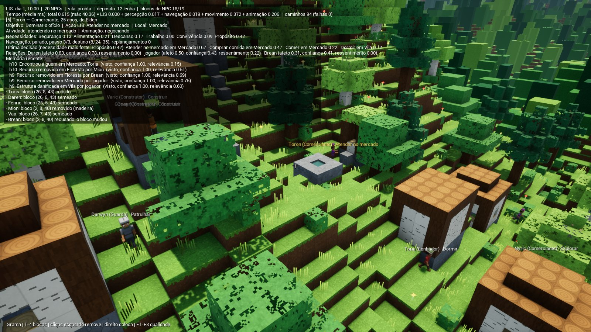

# Vila de Elden no mundo voxel (LIS 03)

Este documento explica onde a vila fica, como ela é planejada e construída, quais regras protegem o mundo do jogador e o que cada profissão faz de fato.

## Como abrir a demonstração

```powershell
& 'D:\Epic Games\UE_5.8\Engine\Binaries\Win64\UnrealEditor.exe' 'D:\ECOS_DE_AETHRA_LIS3\EcosDeAethra.uproject' -game -windowed -ResX=1600 -ResY=900 -AethraElden
```

`-AethraElden` abre o mundo de demonstração, com seed 673 (`FAethraLisVillage::DemoSeed`). Ele tem saves próprios: os slots `AethraWorld_673_*` e o arquivo `Saved/LIS/World_673.lis`. O mundo do jogador (seed 42819) nunca é tocado. `-AethraSeed=<n>` escolhe outro seed.

No primeiro início, a vila é construída a 8 blocos por quadro, o que leva cerca de 10 s. A partir daí ela só é carregada.

`aethra.lis.RemoveVillage` devolve o terreno: cada bloco da vila que ainda estiver no lugar volta a ser o bloco gerado, e as árvores removidas voltam a crescer.

## Planta

São 11 locais em volta da praça. Cada um fica de frente para a praça, e a porta tem um degrau ou uma escada até o chão.

| Local | Tamanho | Conteúdo | Ponto do LIS |
|---|---|---|---|
| Praça | 3×3 | Poço de pedra com água | Vila |
| Mercado | 3×3 | Barraca: 4 postes, cobertura de folhas de bétula, balcão | Mercado |
| Depósito | 5×4 | Paredes de bétula, toras empilhadas dentro, porta | — |
| Oficina | 5×4 | Galpão aberto: 4 postes, telhado, bancada (tora) e bigorna (pedra) | — |
| Área de descanso | 5×3 | Banco e fogueira de pedra | — |
| 5 casas | 5×5 | Paredes de bétula, cantos de tora, porta, 3 janelas, telhado de duas camadas, piso e fundação de pedra | — |
| Fazenda | 7×7 | Cerca baixa de bétula, porteira, canteiros nivelados com terra e 3 fileiras de cultivo (15 canteiros) | Campos |

- **Casas:** 4 moradores cada (casa = (id − 1) / 4). Cada morador tem uma cama no interior de 3×3.
- **Caminhos:** a vegetação gerada é limpa ao longo das rotas entre a praça e cada porta.
- **Floresta, rio e ermo:** continuam escolhidos no terreno como no LIS 02.

## Planejamento

O código fica em `FAethraLisVillage::Plan` e segue quatro passos:

1. **Mapa de terreno aberto:** cobre 121×121 células em volta do spawn e é somado em janelas de 17×17 por imagem integral. A distância pesa um pouco. Os 40 melhores centros são candidatos à praça.
2. **Praça:** o primeiro lugar plano e livre perto desses centros.
3. **Demais locais:** testados em anéis em volta da praça, com 36 ângulos e raio crescente. Cada lote precisa de:
   - terreno que o jogador nunca editou (a coluna inteira igual à gerada);
   - inclinação máxima de 2 blocos (1 para praça e descanso);
   - espaço livre acima até o telhado;
   - margem de 1 célula entre lotes;
   - escada da porta encontrando o chão em até 6 degraus, sem chão acima do piso na frente da porta;
   - caminho a partir da praça.
4. **Núcleo obrigatório:** mercado, depósito, oficina, fazenda e pelo menos 3 casas. Se faltar algum, nada é construído, e o LIS usa os pontos do LIS 02 sem vila.

## Regras de proteção do mundo

- **Só espaço vazio:** a vila é construída apenas em ar ou em vegetação rasteira que o terreno gerou (capim, flores). Blocos sólidos, árvores, água e qualquer edição do jogador ficam como estão: a célula ocupada é pulada e contada como preservada. O teste `Aethra.LISVillage.09` coloca um bloco do jogador numa célula de parede antes da obra e confirma que ele continua lá.
- **Edições passam pelo motor:** toda alteração usa `AAethraVoxelWorld::SetBlockBy` com `FAethraInstigator::Environment(1)`. O motor valida e salva normalmente, e o formato de save voxel não muda.
- **Sem memória falsa:** a construção e o trabalho nos canteiros não viram memórias do LIS. O dano de outra pessoa a um bloco da vila vira o evento "Estrutura danificada", visto por quem está perto.
- **Sem reconstrução automática:** um bloco da vila que o jogador quebra não é reconstruído. Os construtores vão inspecionar, mas não refazem nada sem uma regra de permissão, que ainda não existe.

### Exceção só no mundo de demonstração (decisão para aprovação)

O gerador cobre de floresta praticamente toda a terra seca entre as alturas 21 e 60. Varri os seeds de 1 a 4.000: nenhum tem mais de 2 lotes abertos de 7×7 perto do spawn. Seguindo a regra estrita, a vila não cabe em seed nenhum.

Por isso, só no mundo de demonstração isolado (`bDemoVillage`), a vila derruba as árvores geradas que estão sobre os lotes, na margem e na linha da escada: tronco e copa inteira. No demo foram 681 blocos.

- **Nunca uma edição do jogador:** a célula precisa ser idêntica à gerada.
- **Reversível:** as árvores ficam registradas e `RemoveVillage` as faz crescer de novo.
- **Mundos normais:** a regra estrita continua valendo, e na seed 42819 a vila não é construída.

Essa exceção interpreta a autorização "se necessário, utilize um mundo ou seed específica de demonstração". Precisa da sua aprovação.

## Persistência

- **No save do LIS:** os locais vão em `FLisWorld::Sites` (versão 4 do save), com um marcador "construída" ao fim da obra. Ao reabrir, a vila não é construída de novo; a lista de blocos é recalculada a partir dos locais e do terreno gerado.
- **No save voxel:** os blocos ficam lá, como qualquer edição.
- **Habitantes:** a posição de cada corpo vai no save do LIS (`FLisNpc::WorldCell`), e o habitante reaparece onde estava (teste `Aethra.LISVillage.06`).

## Profissões: o que é real e o que é provisório

| Profissão | O que faz no mundo | Real | Provisório |
|---|---|---|---|
| Agricultor | Vai à fazenda, escolhe um canteiro livre (os agricultores não disputam o mesmo), trabalha com a enxada e a cada hora de jogo colhe (capim → ar) ou semeia (ar → capim) | Troca de bloco validada pelo motor e restrita aos canteiros | A comida produzida vem do estoque abstrato dos Campos no LIS, não dos canteiros; o capim alto faz papel de plantação |
| Lenhador | Acha um tronco alcançável na floresta (nunca um poste da vila), golpeia e pede a remoção de 1 bloco por hora | Cada bloco removido vira 1 de lenha no LIS (`ReportYield`); sem bloco removido, não há lenha | Sem replantio |
| Construtor | Busca material no depósito (cesto), vai à bancada da oficina e martela | Cada ação concluída consome 1 lenha do depósito, a lenha que os lenhadores venderam | O "material preparado" (`World.Prepared`) ainda não tem uso; não constrói nada sem permissão. Com dano recente e sem lenha, vai inspecionar o local |
| Comerciante | Vai à barraca (um atrás do balcão, os outros na frente), observa o estoque do mercado e participa das vendas e compras dos outros | Fica com uma parte de cada negociação | Não há inventário de itens: as trocas são valores do LIS |

Todas as atividades são escolhidas pela IA utilitária do LIS (ações `Build` e `Tend` novas, profissão Construtor nova). O corpo só executa o que o LIS escolheu.

## Capturas

Capturas reais do jogo, feitas no motor com `-AethraElden -AethraLisShots`:

| Arquivo | O que mostra |
|---|---|
| `captures/lis03_01_vila_inicio.jpg` | Visão geral às 7h, logo após a construção |
| `captures/lis03_02_praca.jpg` | Praça com o poço e os habitantes |
| `captures/lis03_03_fazenda.jpg` | Agricultores com enxada nos canteiros cercados |
| `captures/lis03_04_oficina.jpg` | Construtores martelando na bancada, com o painel aberto |
| `captures/lis03_05_reacao_ao_dano.jpg` | Comerciante na barraca, com a memória do dano à casa |
| `captures/lis03_06_vila_10h.jpg` | Vila às 10h, com a relação com o jogador alterada no painel |
| `captures/lis03_07_reaberto_comerciante.jpg` | Depois de fechar e reabrir: a mesma memória e a mesma relação |
| `captures/lis03_08_reaberto_vila.jpg` | Depois de reabrir: a vila intacta e os habitantes trabalhando |



## Limitações

- A vila é sempre a mesma planta-base, adaptada ao terreno; não há cidades procedurais.
- Os interiores são vazios: não há cama, mesa ou baú. As toras empilhadas do depósito não mudam com o estoque.
- A construção inicial causa engasgos de 20 a 50 ms por quadro durante cerca de 10 s, porque cada `SetBlockBy` salva o arquivo e reconstrói o chunk.
- No mundo do jogador (seed 42819), com a regra estrita, não há espaço: o LIS roda sem vila, como no LIS 02.
