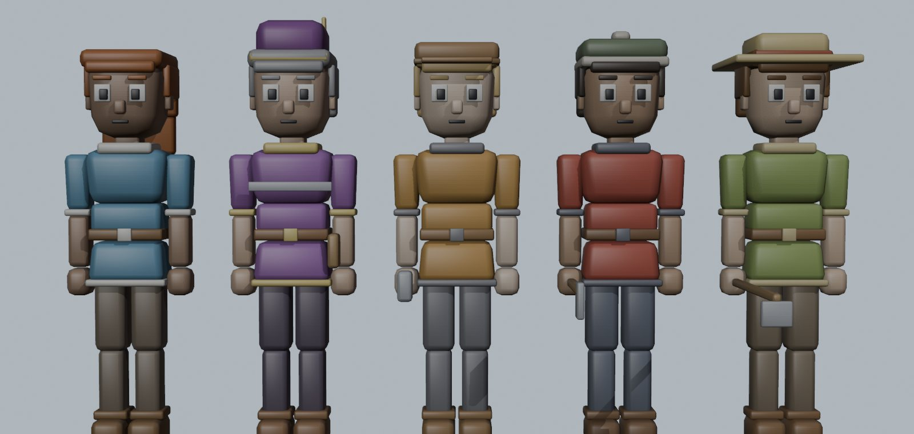

# Habitantes 3D: modelo e aparência (LIS 03)

Este documento descreve o personagem-base usado pelos 20 habitantes de Elden, como ele é gerado, como cada habitante ganha aparência própria e o que ainda é provisório.

## Personagem-base

O modelo foi criado do zero por script no Blender 5.3, sem assets de terceiros:

| Item | Valor |
|---|---|
| Arquivo-fonte | `Tools/Blender/make_villager.py` |
| Malha | `SK_Villager`: 2.240 vértices e 2.160 faces |
| Esqueleto | 18 ossos: root, pelvis, spine, chest, neck, head, e upperarm, lowerarm, hand, thigh, calf e foot de cada lado |
| Altura | cerca de 1,73 m (escala de altura de 0,93 a 1,06 por habitante) |
| Material | `M_Villager`, um único material para o corpo e os acessórios |
| Acessórios | 11 malhas estáticas: 5 chapéus, cabelo longo, 4 ferramentas e uma bolsa |

**Proporções e estilo.** O corpo é feito de blocos com bordas chanfradas e sombreamento suave, para combinar com o mundo voxel modernizado. A cabeça é grande (cerca de 1/4,8 da altura) e o nariz é saliente. Os olhos têm branco e pupila. O habitante veste túnica com barra, cinto com fivela, lenço, mangas com punho, calça e botas com cano. A silhueta não copia nenhum jogo: não é o corpo cilíndrico do Roblox nem o cubo plano do Minecraft.

**Esqueleto rígido.** Cada parte do corpo pertence 100% a um osso. As juntas não esticam, o que mantém o visual de blocos e torna o skinning barato.

**Material indexado.** As regiões de cor não são slots de material. A coordenada UV0.x de cada vértice guarda o índice da região: 0 pele, 1 túnica, 2 calça, 3 couro, 4 cabelo, 5 pupila, 6 branco dos olhos e 7 detalhe. `M_Villager` escolhe a cor nos parâmetros `Color0` a `Color7`. Cada habitante tem uma instância dinâmica com suas cores, e o corpo inteiro é uma única seção de malha, ou seja, uma chamada de desenho. Chapéu, ferramenta, cabelo longo e bolsa somam até quatro chamadas a mais.

## Variações

Elas são calculadas a partir do id persistente do LIS. O mesmo habitante tem sempre a mesma aparência, inclusive depois de reiniciar.

- **Pele:** 6 tons.
- **Cabelo:** 5 cores. Habitantes com mais de 55 anos ficam grisalhos.
- **Cabelo longo:** cerca de 45% dos habitantes.
- **Calça:** 5 cores. O detalhe (lenço, barra e fivela) tem outras 5.
- **Couro:** tom variável.
- **Túnica:** cor da profissão, com brilho variando ±15%.
- **Corpo:** altura entre 0,93 e 1,06; largura entre 0,94 e 1,06. Jovens são um pouco menores.

## Elementos de profissão

| Profissão | Túnica | Chapéu | Ferramenta (só durante o trabalho) |
|---|---|---|---|
| Agricultor | verde | palha com faixa vermelha | enxada (cesto ao colher ou semear) |
| Lenhador | vermelha | gorro verde ou vermelho | machado |
| Construtor | laranja | boné de couro com aba | cesto no depósito, martelo na bancada |
| Comerciante | roxa | chapéu alto com pena dourada | bolsa a tiracolo (sempre) |
| Pescador | azul | palha com faixa azul | nenhuma (falta uma vara) |
| Guarda | cinza | elmo | nenhuma |

A ferramenta aparece quando a ação do LIS pede e some quando ela termina. O teste `Aethra.LISVillage.02` verifica que o chapéu corresponde à profissão e se mantém depois de reiniciar.

## Como regenerar

```powershell
& 'C:\Program Files\Blender Foundation\Blender 5.3\blender.exe' -b --factory-startup --python Tools/Blender/make_villager.py -- SourceArt/Villager
```
```powershell
& 'D:\Epic Games\UE_5.8\Engine\Binaries\Win64\UnrealEditor-Cmd.exe' EcosDeAethra.uproject -run=pythonscript -script=Tools/Editor/import_villager.py -EnablePlugins=PythonScriptPlugin -unattended -nosplash -nullrhi
```

O primeiro comando gera os FBX e a imagem `SourceArt/Villager/preview.png`, com cinco variações lado a lado (cópia em `captures/lis03_00_modelos.jpg`; o PNG não é versionado). O segundo cria `M_Villager` e importa os assets para `/Game/Characters/Villager`, usando o importador FBX legado. Os dois scripts podem ser rodados de novo sem efeito colateral.



## Limitações

- **Malha única:** não há LOD de malha. A 50 m a pose passa a ser atualizada só 4 vezes por segundo, e acima de 150 m o corpo é escondido.
- **Rosto fixo:** não há expressões nem boca animada.
- **Juntas:** como o skinning é rígido, as juntas mostram pequenas sobreposições ao dobrar.
- **Colisão:** a cápsula tem altura fixa de 1,8 m e não muda com a escala do corpo.
- **Faltam:** vara de pescar, roupa de dormir e um chapéu próprio para explorador e pescador.
