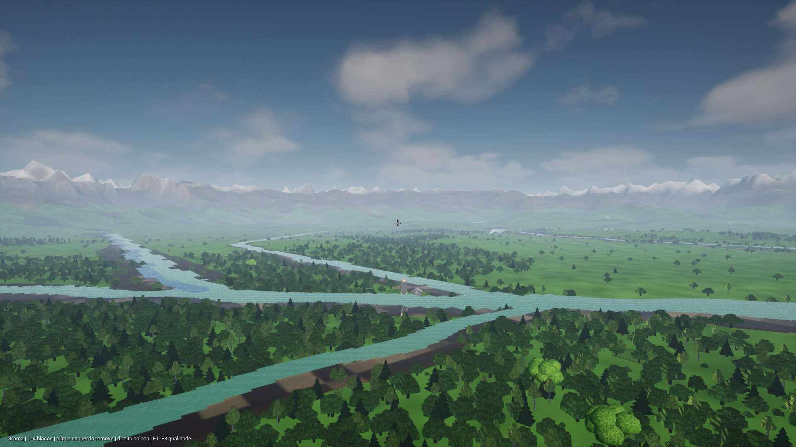
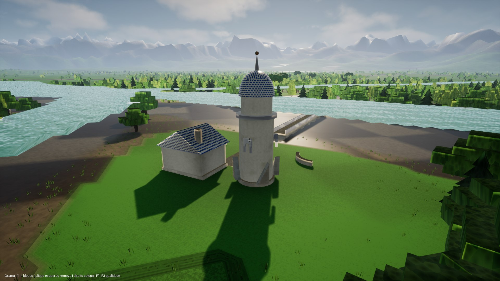
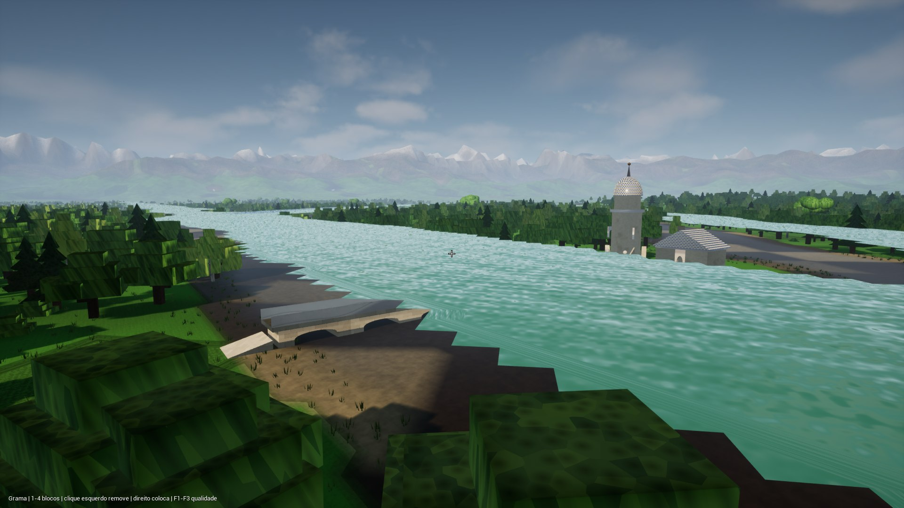
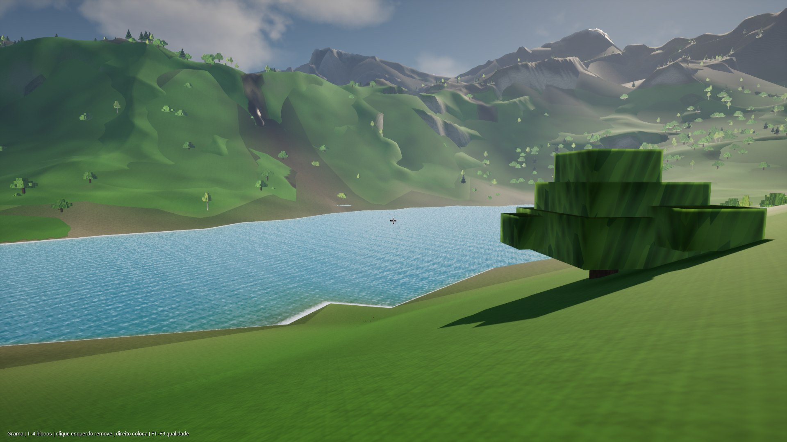
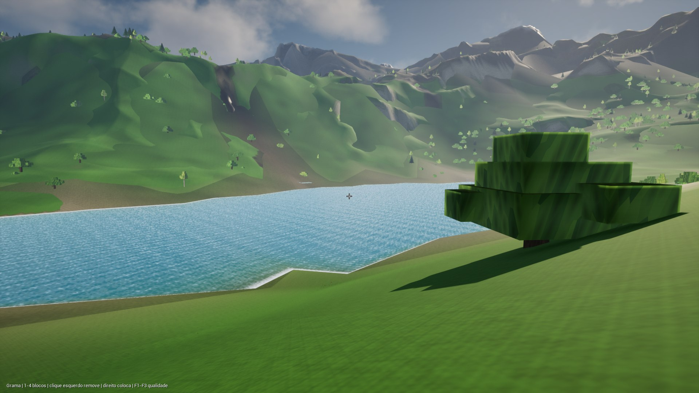
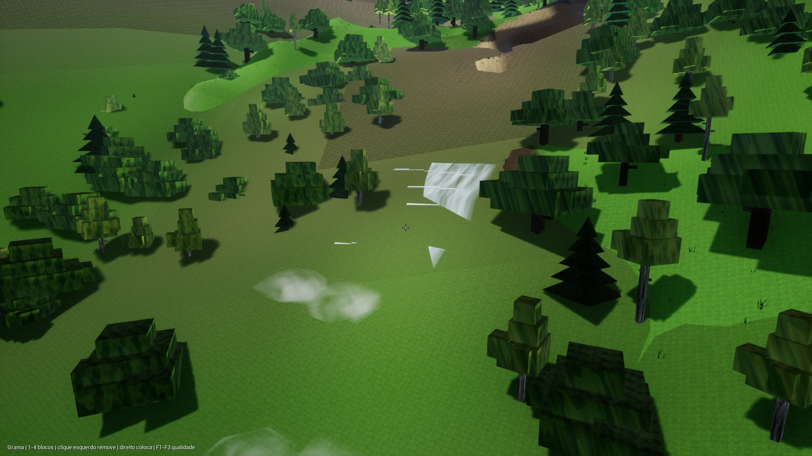
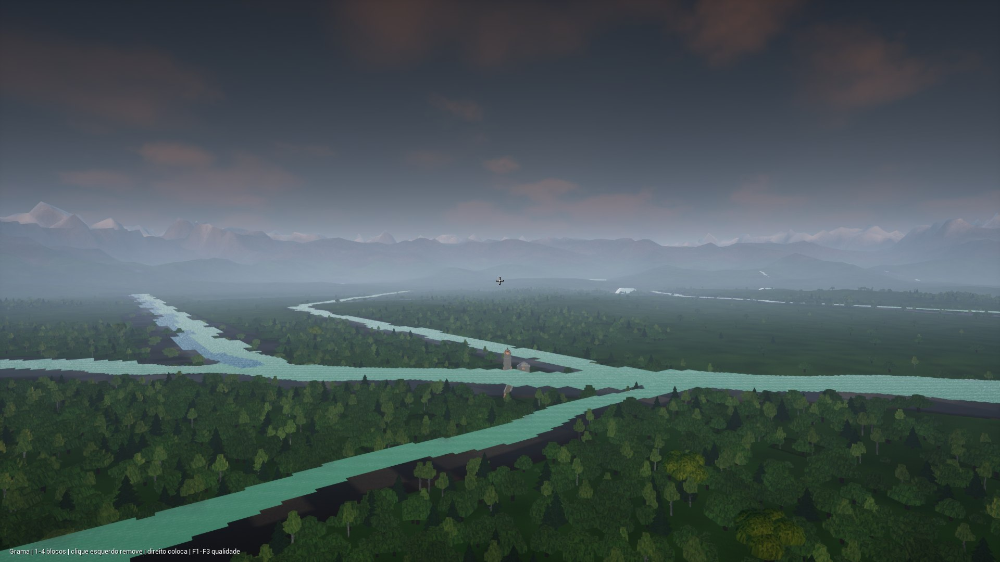
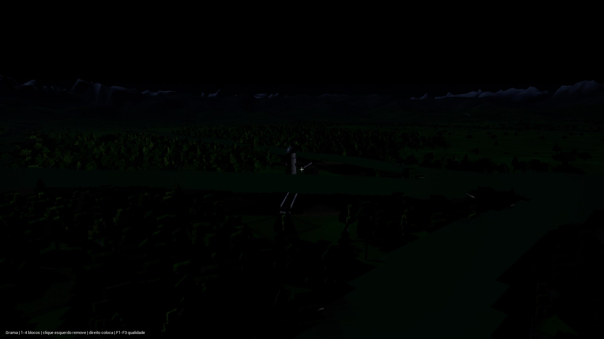

# Aethra Visual World — Protótipo 01

Identidade visual oficial, geração procedural avançada e sistema de materiais (Prompt Mestre 07, com o adendo de vegetação). Branch `claude/aethra-visual-worldgen-01`. UE 5.8.

## Rodar

1. Compile o editor:

   ```powershell
   & 'D:\Epic Games\UE_5.8\Engine\Build\BatchFiles\Build.bat' EcosDeAethraEditor Win64 Development '-Project=D:\ECOS_DE_AETHRA_VW\EcosDeAethra.uproject' -WaitMutex
   ```

2. Abra o Visual World. A seed é opcional; sem ela, usa a 125.

   ```powershell
   & 'D:\Epic Games\UE_5.8\Engine\Binaries\Win64\UnrealEditor.exe' 'D:\ECOS_DE_AETHRA_VW\EcosDeAethra.uproject' -game -windowed -ResX=1920 -ResY=1080 -AethraVisualWorld
   ```

Opções:
- `-AethraVWShots` tira as 8 capturas e encerra.
- A variável de console `aethra.vw.Hour 0–24` muda a hora (padrão 16).
- Sem `-AethraVisualWorld`, o jogo é o mundo voxel de sempre.

Para recriar os materiais (`Content/VisualWorld`), rode `Tools/Editor/create_visualworld_materials.py` pelo commandlet `pythonscript`.

## Documentos

| Documento | Conteúdo |
| --- | --- |
| [ART_DIRECTION.md](ART_DIRECTION.md) | Avaliação das referências e identidade |
| [MATERIAL_ENGINE.md](MATERIAL_ENGINE.md) | AME |
| [WORLDGEN_ARCHITECTURE.md](WORLDGEN_ARCHITECTURE.md) | Gerador, drenagem, biomas e streaming |
| [HYDROGEN.md](HYDROGEN.md) | Água; o que é visual e o que é simulado |
| [HYBRID_GEOMETRY.md](HYBRID_GEOMETRY.md) | AHG |
| [FLORA.md](FLORA.md) | Espécies (adendo de vegetação) |
| [PROCEDURAL_ARCHITECTURE.md](PROCEDURAL_ARCHITECTURE.md) | CivGen-lite |
| [PERFORMANCE.md](PERFORMANCE.md) | Benchmark |
| [TEST_REPORT.md](TEST_REPORT.md) | Testes |
| [ROADMAP.md](ROADMAP.md) | Próximos passos |

## Capturas (no motor, seed 125, 1920 × 1080)

| | |
| --- | --- |
|  A — planície, rio e montanhas (16 h) |  C — casa, torre e ponte |
|  B — rio verde (algas) e ponte |  B — braço de mar (perfil TropicalSea, 35 g/kg) entre colinas |
|  B — lago |  D — cascata visual (discreta; ver HYDROGEN.md) |
|  Entardecer (17,6 h) |  Noite (22,5 h) |
