# Aethra Visual World

Identidade visual, geração procedural e sistemas de mundo de ECOS DE AETHRA. UE 5.8.

- **Protótipo 01** (Prompt Mestre 07 e adendo de vegetação): branch `claude/aethra-visual-worldgen-01`.
- **Prompt Mestre 08** (FloraGen, campos de flores, perfis, horizonte alcançável, CaveGen e RuinGen): branch `claude/aethra-floragen-cavegen-02`, que parte da anterior.
- **Mundo em blocos** (o jogo inteiro em blocos de 1 m, com o rio corrigido): branch `claude/aethra-block-world-03`. Agora é o modo padrão; veja [BLOCK_WORLD.md](BLOCK_WORLD.md).

## Rodar

1. Compile o editor:

   ```powershell
   & 'D:\Epic Games\UE_5.8\Engine\Build\BatchFiles\Build.bat' EcosDeAethraEditor Win64 Development '-Project=D:\ECOS_DE_AETHRA_VW\EcosDeAethra.uproject' -WaitMutex
   ```

2. Abra o Visual World. A seed é opcional; sem ela, usa a 125.

   ```powershell
   & 'D:\Epic Games\UE_5.8\Engine\Binaries\Win64\UnrealEditor.exe' 'D:\ECOS_DE_AETHRA_VW\EcosDeAethra.uproject' -game -windowed -ResX=1920 -ResY=1080 -AethraVisualWorld
   ```

Opções:
- `-AethraVWShots` tira as 12 capturas e encerra.
- Variáveis de console:
  - `aethra.vw.Hour 0–24` muda a hora (padrão 16).
  - `aethra.vw.Quality 0–3` escolhe o perfil (Baixo, Médio, Alto, Ultra; padrão Alto).
  - `aethra.vw.Hide` e `aethra.vw.ShowHorizon` ocultam camadas para depuração (ver HORIZON.md).
- Os botões de remover e colocar bloco escavam ou preenchem o terreno e a rocha.
- Sem `-AethraVisualWorld`, o jogo abre o mundo em blocos de Aethra. O mundo voxel original abre com `-AethraClassic`.

Para recriar os materiais (`Content/VisualWorld`), rode `Tools/Editor/create_visualworld_materials.py` pelo commandlet `pythonscript`.

## Documentos

| Documento | Conteúdo |
| --- | --- |
| [BLOCK_WORLD.md](BLOCK_WORLD.md) | O mundo em blocos: geradores em blocos de 1 m e a correção do rio |
| [ART_DIRECTION.md](ART_DIRECTION.md) | Referências, identidade e decisões oficiais do Prompt 08 |
| [MATERIAL_ENGINE.md](MATERIAL_ENGINE.md) | AME e as regras contra aparência de massinha |
| [WORLDGEN_ARCHITECTURE.md](WORLDGEN_ARCHITECTURE.md) | Gerador, drenagem, biomas e streaming |
| [HORIZON.md](HORIZON.md) | Horizonte real e alcançável, LOD e transições |
| [HYDROGEN.md](HYDROGEN.md) | Água; o que é visual e o que é simulado |
| [HYBRID_GEOMETRY.md](HYBRID_GEOMETRY.md) | AHG |
| [FLORA.md](FLORA.md) | FloraGen, árvores e campos de flores |
| [CAVEGEN.md](CAVEGEN.md) | Cavernas e escavação |
| [RUINGEN.md](RUINGEN.md) | Ruínas de civilizações antigas |
| [PROCEDURAL_ARCHITECTURE.md](PROCEDURAL_ARCHITECTURE.md) | CivGen-lite |
| [PERFORMANCE.md](PERFORMANCE.md) | Benchmarks e perfis gráficos |
| [TEST_REPORT.md](TEST_REPORT.md) | Testes |
| [ROADMAP.md](ROADMAP.md) | Feito e próximos passos |

## Capturas do Prompt 08 (no motor, seed 125, 1920 × 1080, perfil Alto)

| | |
| --- | --- |
| 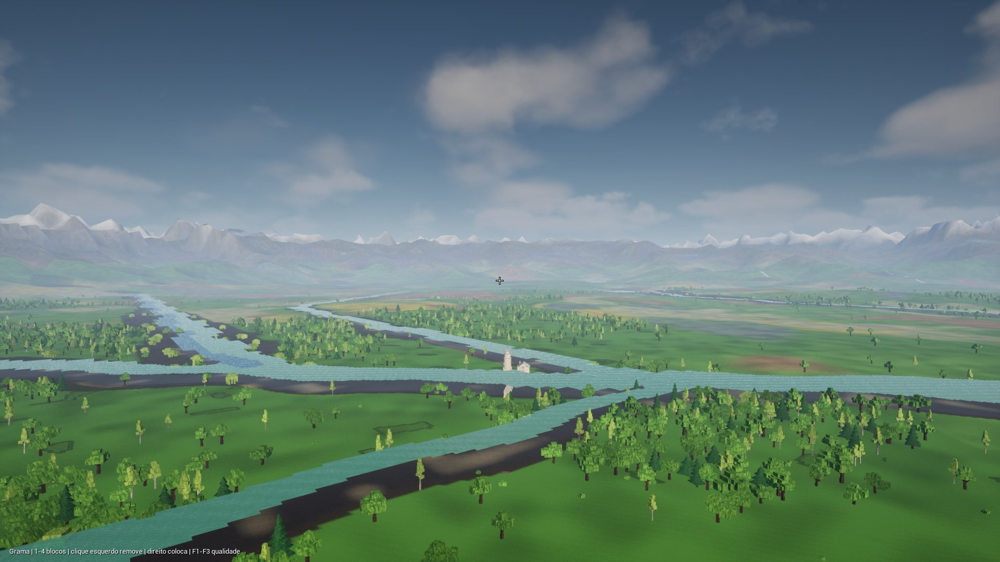 A — planície, rio e montanhas | 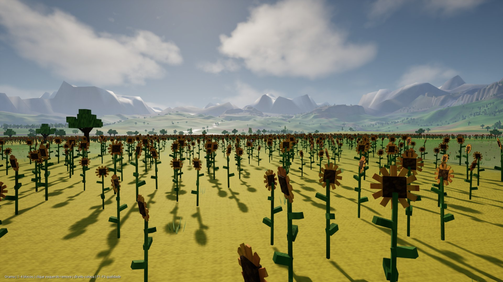 B — campo de girassóis |
| 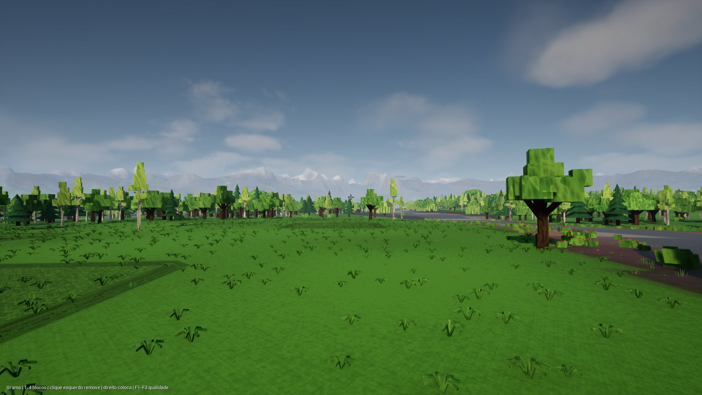 C — floresta geométrica e clareira | 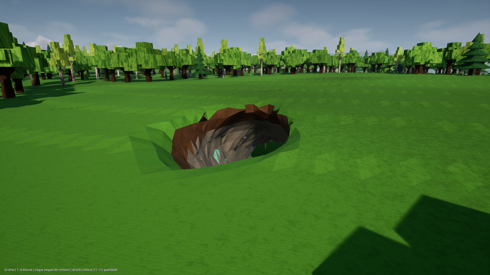 D — entrada da caverna |
| 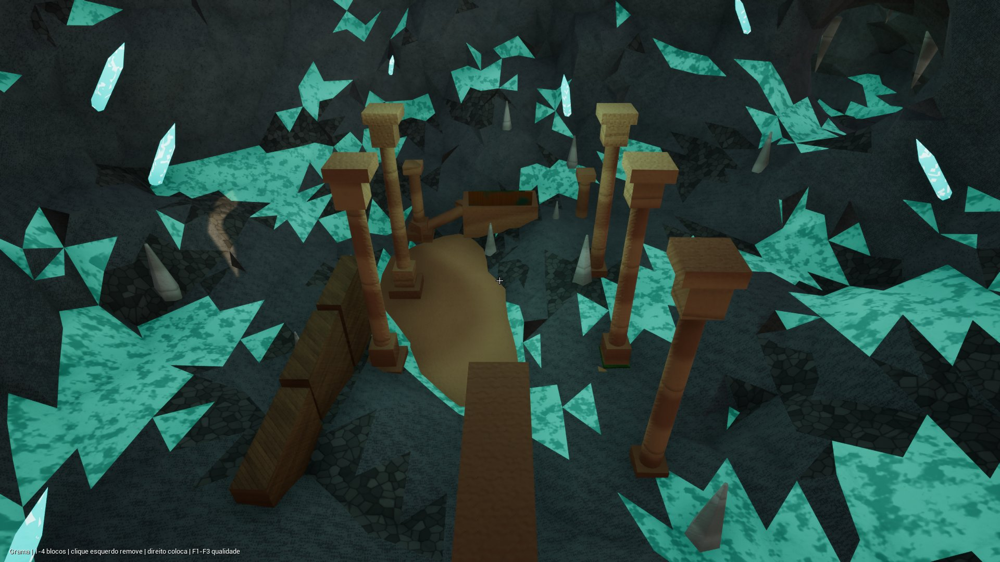 D — caverna encantada com salão em ruínas | 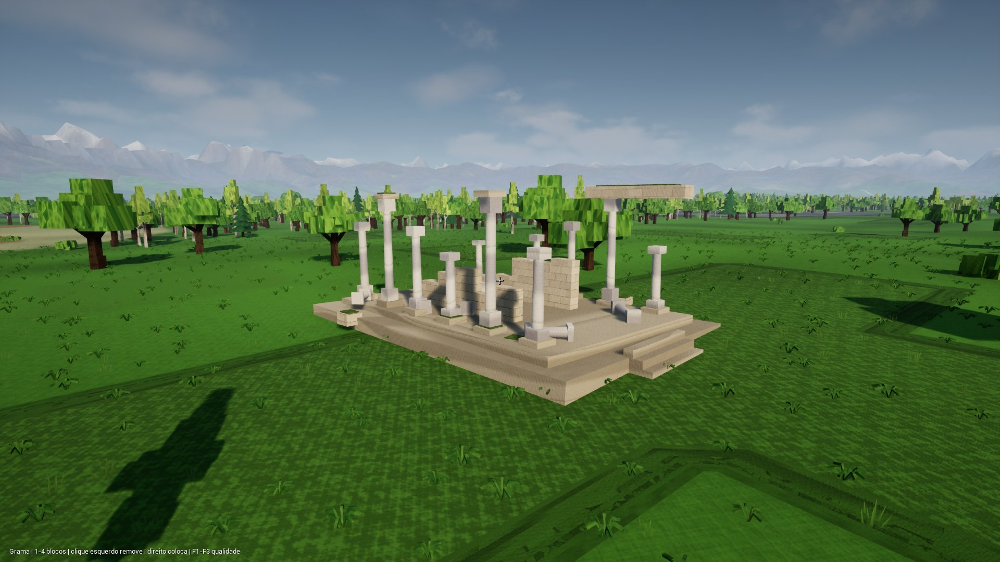 Ruína de templo Aldarim |
| 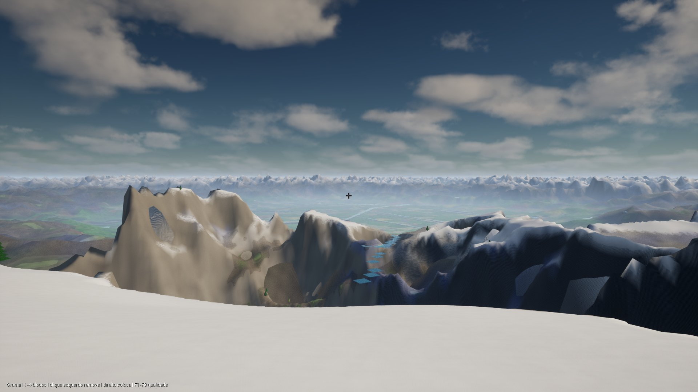 Horizonte do alto da montanha | 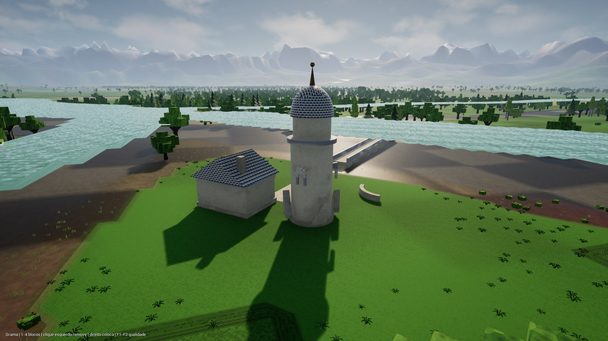 Casa e torre da vila |
| 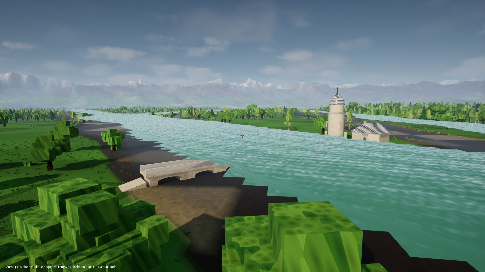 Rio e ponte | 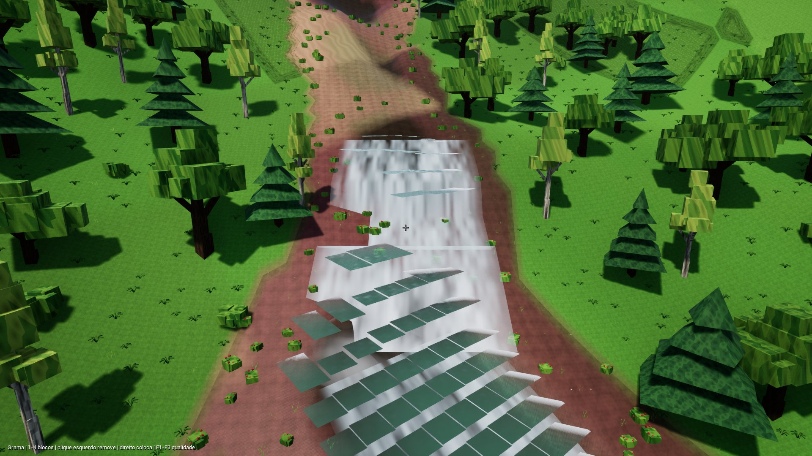 Cachoeira (visual, discreta) |
| 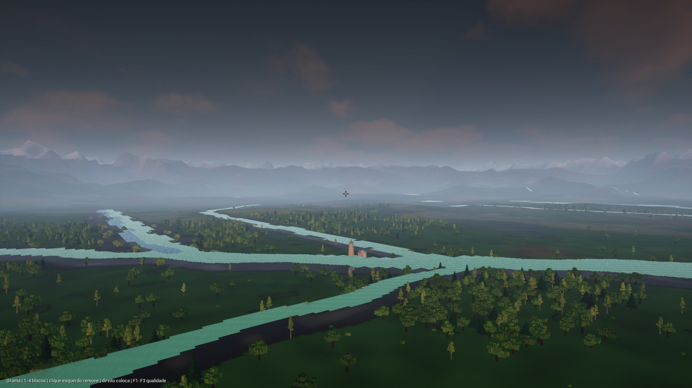 Entardecer (17,6 h) | 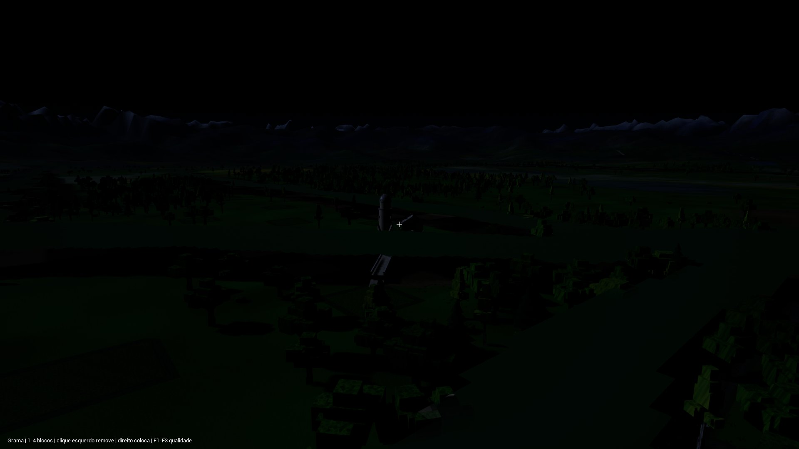 Noite (22,5 h) |

As capturas do Protótipo 01 continuam em [captures/](captures/).
